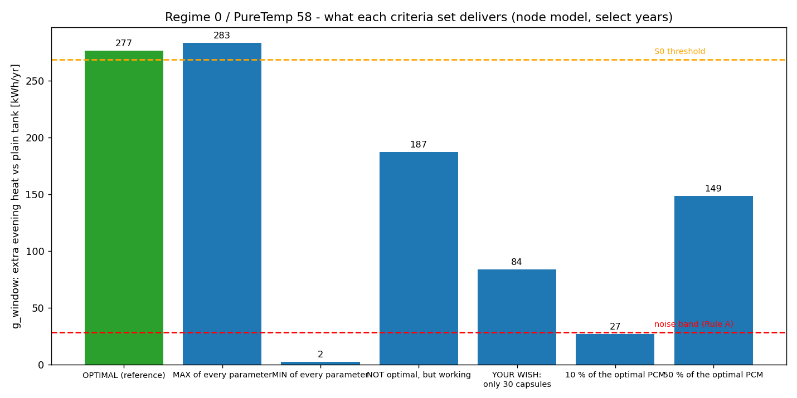

# Criteria study - what happens if the design is not the optimum?

Regime 0, PureTemp 58, 100 L tank. Every row is a real run of the optimiser's simulator (multi-node tank, select years 2021-23) paired with the plain-water tank; the Fluent folders show the same designs as a whole-tank discharge (capsules melted at 70 C, water 30 C, no sun).

**2-D proxy:** the planar Fluent slice draws `round(N*34/104)` capsules of inner radius `0.5*R_in` - the optimum is the existing 34-capsule / 20 mm picture. Flow rate and arrangement act in the node model only (the discharge has no flow).

**Interactive portal (videos, stills, every parameter, live graphs):** [`CRITERIA_PORTAL.html`](CRITERIA_PORTAL.html) - a dropdown picks one of the 7 criteria, or "ALL TOGETHER". Each criteria panel has: design parameters, the PCM's physical properties (Tm, latent heat, conductivity, density, cp), the Fluent run's boundary/initial conditions and mesh, the safety gates and annual objectives (peak PCM/water temperature, g_annual, d_overheat, the repeatability band), an **animated GIF video** of the whole discharge (temperature + liquid-fraction contours, every 5 simulated minutes), the START/MID/END stills, timing (time to half-discharge, time to fully solidify, total heat delivered), and a live water/PCM-temperature + liquid-fraction graph. "ALL TOGETHER" overlays every criteria's curves and compares the optimum against every alternative.

Per-criteria written summary with the same numbers: [`HOW_THEY_CHANGE.md`](HOW_THEY_CHANGE.md). How each parameter travels from the raw inputs to this study: [`../docs/OBJ2_DATA_FLOW_INPUT_TO_OUTPUT.md`](../docs/OBJ2_DATA_FLOW_INPUT_TO_OUTPUT.md).

| folder | R_in | N real (drawn) | PCM kg | flow | arrangement | g_window kWh/yr | % of optimal | verdict |
|---|---|---|---|---|---|---|---|---|
| [criteria_0_optimal_reference](criteria_0_optimal_reference/README.md) | 40 mm | 104 (34) | 24.8 | 0.039 | staggered | 276.6 | 100 % | OPTIMAL (this is the selected design) |
| [criteria_1_max_all](criteria_1_max_all/README.md) | 40 mm | 105 (34) | 25.1 | 0.050 | staggered | 283.3 | 102 % | statistically TIED with the optimum (gain difference +6.7 kWh is inside the 28.4 kWh band); loses the final tie-break: PCM mass 25.05 vs 24.81 kg, 105 vs 104 capsules |
| [criteria_2_min_all](criteria_2_min_all/README.md) | 10 mm | 380 (124) | 1.4 | 0.010 | single-layer | 2.2 | 1 % | eliminated at Rule A (gain inside the noise band = no better than a plain tank) |
| [criteria_3_ok_not_optimal](criteria_3_ok_not_optimal/README.md) | 40 mm | 80 (26) | 19.1 | 0.023 | staggered | 187.5 | 68 % | works and beats plain water, but eliminated at S0 (too far below the best g_window) |
| [criteria_4_only_30_capsules](criteria_4_only_30_capsules/README.md) | 40 mm | 30 (10) | 7.2 | 0.039 | staggered | 83.6 | 30 % | works and beats plain water, but eliminated at S0 (too far below the best g_window) |
| [criteria_5_10pct_of_optimal](criteria_5_10pct_of_optimal/README.md) | 40 mm | 10 (3) | 2.4 | 0.039 | staggered | 26.9 | 10 % | eliminated at Rule A (gain inside the noise band = no better than a plain tank) |
| [criteria_6_50pct_of_optimal](criteria_6_50pct_of_optimal/README.md) | 40 mm | 52 (17) | 12.4 | 0.039 | staggered | 148.5 | 54 % | works and beats plain water, but eliminated at S0 (too far below the best g_window) |

Data flow of the whole objective: `../docs/OBJ2_DATA_FLOW_INPUT_TO_OUTPUT.md`.