# How the criteria change - ANSYS Fluent whole-tank discharge + node model

Capsules start melted at 70 C, tank water at 30 C, no sun, sealed tank. Fluent shows the SHAPE and TIME behaviour on a 2-D slice (drawn capsules = round(N*34/104), radius = 0.5 R_in); energy per year comes from the node model.

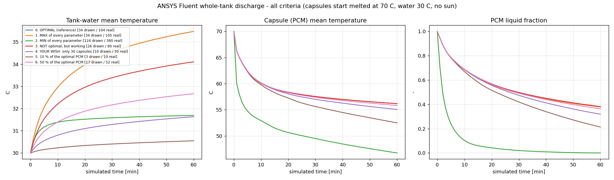

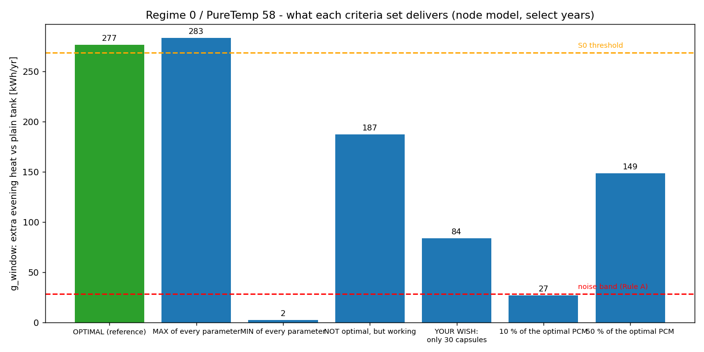

Interactive version: `criteria_common/CRITERIA_interactive.html`.

## 0. OPTIMAL (reference)

The optimiser's selected design (S0/S1/S2 funnel winner): the largest radius, ~30 % PCM fraction, a high-but-not-maximum flow.

Real design: R_in 40 mm, **104 capsules** (24.8 kg PCM), flow 0.0388 kg/s, staggered. Drawn in Fluent: 34 capsules.

Node model: g_window **276.6 kWh/yr (100 % of optimal)**, overheating 829 h/yr. Verdict: OPTIMAL (this is the selected design).

| minute | water avg C | water max C | capsule avg C | liquid fraction | heat to water kJ/m |
|---|---|---|---|---|---|
| 0 | 30.00 | 30.00 | 70.00 | 1.000 | 0 |
| 15 | 33.55 | 50.61 | 58.92 | 0.615 | 3977 |
| 30 | 34.55 | 53.16 | 57.52 | 0.491 | 5100 |
| 45 | 35.09 | 54.29 | 56.75 | 0.425 | 5708 |
| 60 | 35.48 | 55.04 | 56.17 | 0.379 | 6135 |

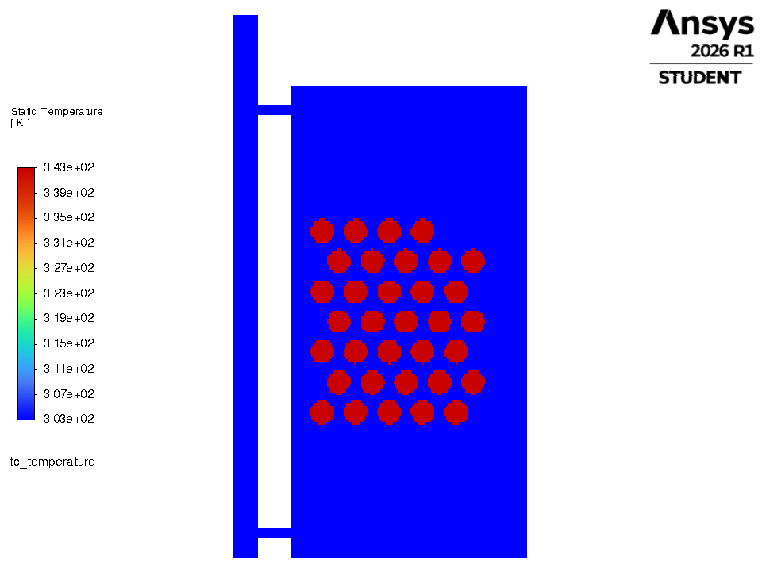

## 1. MAX of every parameter

Every knob at its upper bound: R_in 40 mm, PCM fraction 30 %, flow 0.050 kg/s, densest packing (staggered).  N follows from R and fraction (the 30 % cap at R = 40 mm gives N = 105).

Real design: R_in 40 mm, **105 capsules** (25.1 kg PCM), flow 0.0500 kg/s, staggered. Drawn in Fluent: 34 capsules.

Node model: g_window **283.3 kWh/yr (102 % of optimal)**, overheating 880 h/yr. Verdict: statistically TIED with the optimum (gain difference +6.7 kWh is inside the 28.4 kWh band); loses the final tie-break: PCM mass 25.05 vs 24.81 kg, 105 vs 104 capsules.

| minute | water avg C | water max C | capsule avg C | liquid fraction | heat to water kJ/m |
|---|---|---|---|---|---|
| 0 | 30.00 | 30.00 | 70.00 | 1.000 | 0 |
| 15 | 33.55 | 50.61 | 58.92 | 0.615 | 3977 |
| 30 | 34.55 | 53.16 | 57.52 | 0.491 | 5100 |
| 45 | 35.09 | 54.29 | 56.75 | 0.425 | 5708 |
| 60 | 35.48 | 55.04 | 56.17 | 0.379 | 6135 |

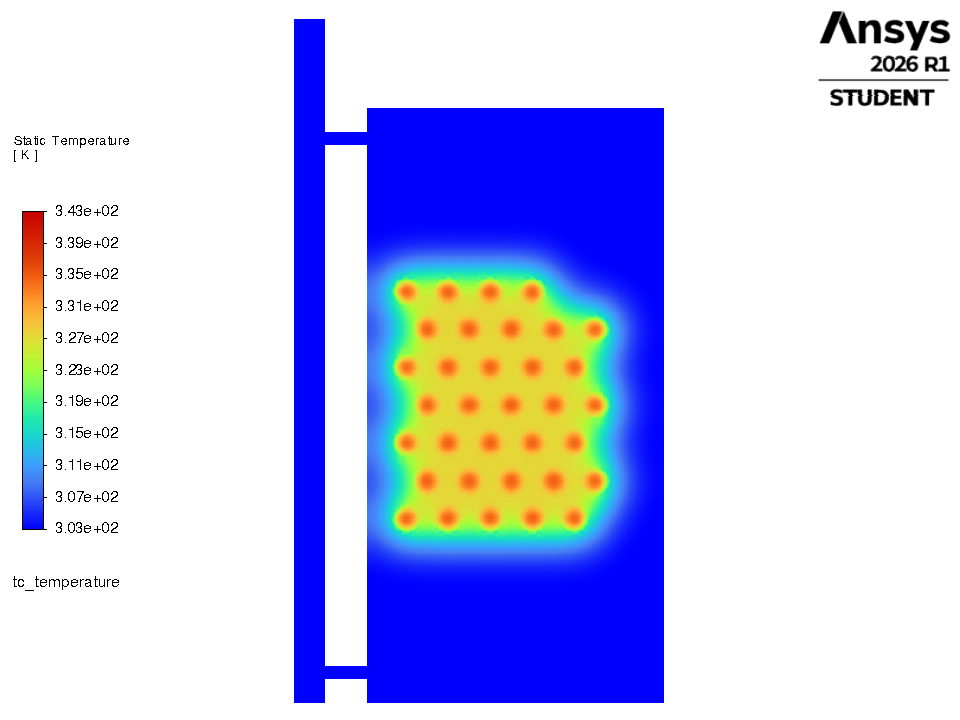
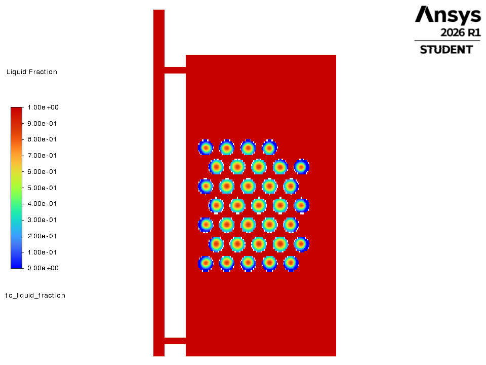

## 2. MIN of every parameter

Every knob at its lower bound: R_in 10 mm, PCM fraction 2 %, flow 0.010 kg/s, loosest packing (single-layer).  N = 380 tiny capsules but only ~2 % of the tank volume (1.4 kg of PCM).

Real design: R_in 10 mm, **380 capsules** (1.4 kg PCM), flow 0.0100 kg/s, single-layer. Drawn in Fluent: 124 capsules.

Node model: g_window **2.2 kWh/yr (1 % of optimal)**, overheating 1418 h/yr. Verdict: eliminated at Rule A (gain inside the noise band = no better than a plain tank).

| minute | water avg C | water max C | capsule avg C | liquid fraction | heat to water kJ/m |
|---|---|---|---|---|---|
| 0 | 30.00 | 30.00 | 70.00 | 1.000 | 0 |
| 15 | 31.47 | 54.65 | 51.50 | 0.059 | 1853 |
| 30 | 31.58 | 54.22 | 49.49 | 0.020 | 1993 |
| 45 | 31.65 | 53.81 | 47.99 | 0.006 | 2071 |
| 60 | 31.69 | 53.08 | 46.73 | 0.000 | 2125 |

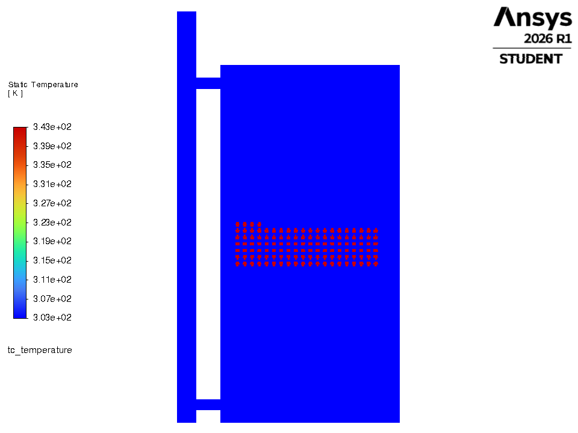
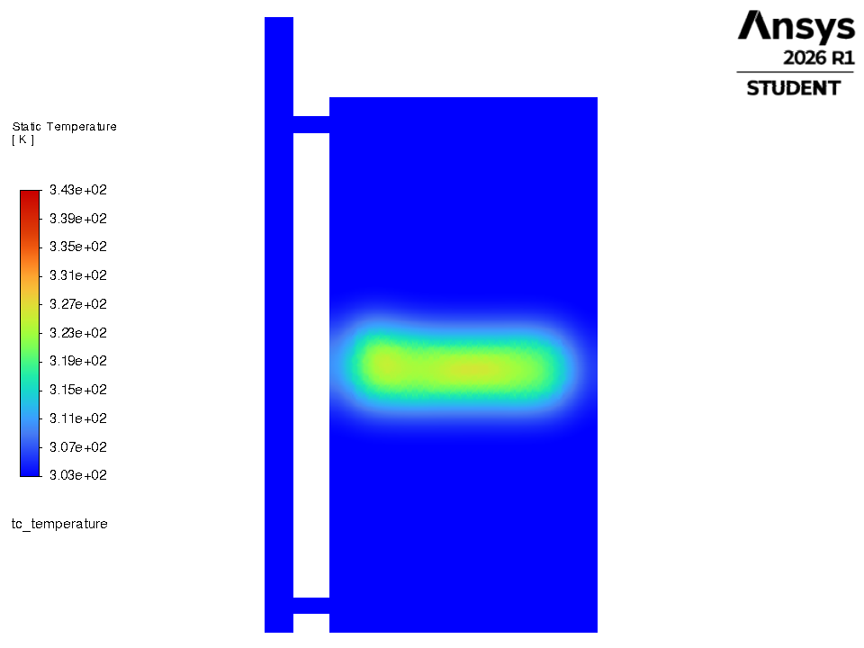
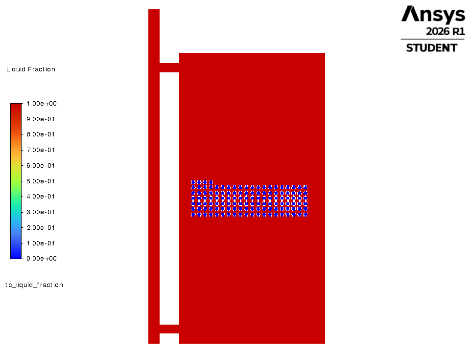

## 3. NOT optimal, but working

A real evaluated candidate from the optimiser's own list (results/g10_selection_candidates_r0.csv): N = 80 capsules, flow 0.0227.  Passes every hard gate and beats the plain tank clearly.

Real design: R_in 40 mm, **80 capsules** (19.1 kg PCM), flow 0.0227 kg/s, staggered. Drawn in Fluent: 26 capsules.

Node model: g_window **187.5 kWh/yr (68 % of optimal)**, overheating 360 h/yr. Verdict: works and beats plain water, but eliminated at S0 (too far below the best g_window).

| minute | water avg C | water max C | capsule avg C | liquid fraction | heat to water kJ/m |
|---|---|---|---|---|---|
| 0 | 30.00 | 30.00 | 70.00 | 1.000 | 0 |
| 15 | 32.64 | 50.77 | 59.01 | 0.620 | 3079 |
| 30 | 33.39 | 53.29 | 57.55 | 0.498 | 3948 |
| 45 | 33.80 | 54.48 | 56.76 | 0.430 | 4433 |
| 60 | 34.10 | 55.23 | 56.17 | 0.381 | 4785 |

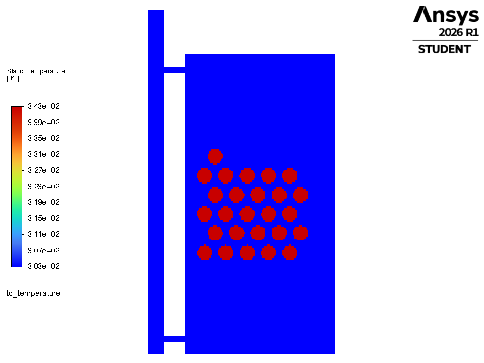
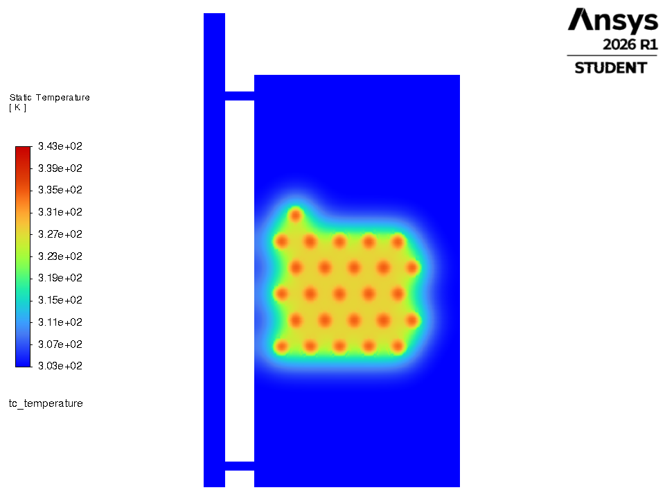
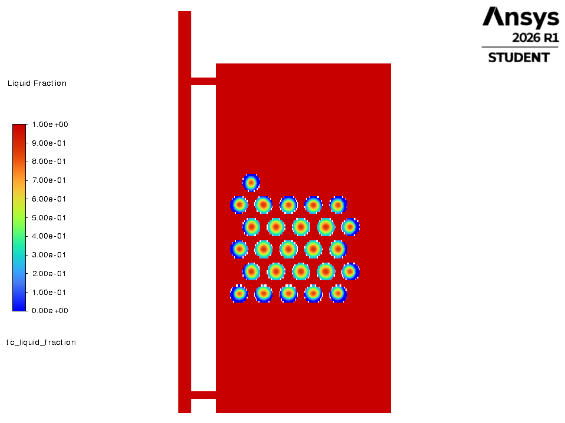

## 4. YOUR WISH: only 30 capsules

Only 30 real capsules (R_in 40 mm, optimal flow, staggered) = 8.5 % PCM fraction.

Real design: R_in 40 mm, **30 capsules** (7.2 kg PCM), flow 0.0388 kg/s, staggered. Drawn in Fluent: 10 capsules.

Node model: g_window **83.6 kWh/yr (30 % of optimal)**, overheating 730 h/yr. Verdict: works and beats plain water, but eliminated at S0 (too far below the best g_window).

| minute | water avg C | water max C | capsule avg C | liquid fraction | heat to water kJ/m |
|---|---|---|---|---|---|
| 0 | 30.00 | 30.00 | 70.00 | 1.000 | 0 |
| 15 | 30.97 | 50.71 | 58.84 | 0.613 | 1221 |
| 30 | 31.28 | 53.18 | 57.00 | 0.474 | 1611 |
| 45 | 31.48 | 54.25 | 55.94 | 0.386 | 1859 |
| 60 | 31.63 | 54.81 | 55.05 | 0.319 | 2050 |

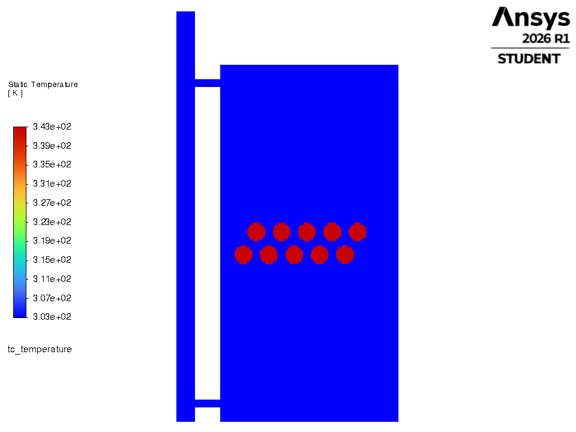
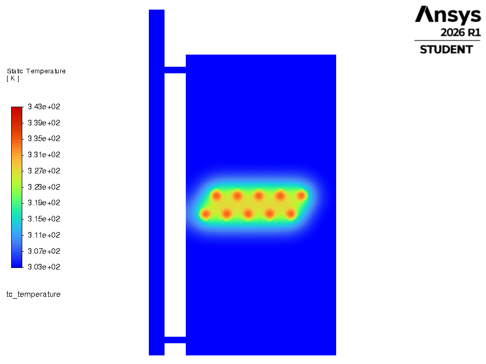
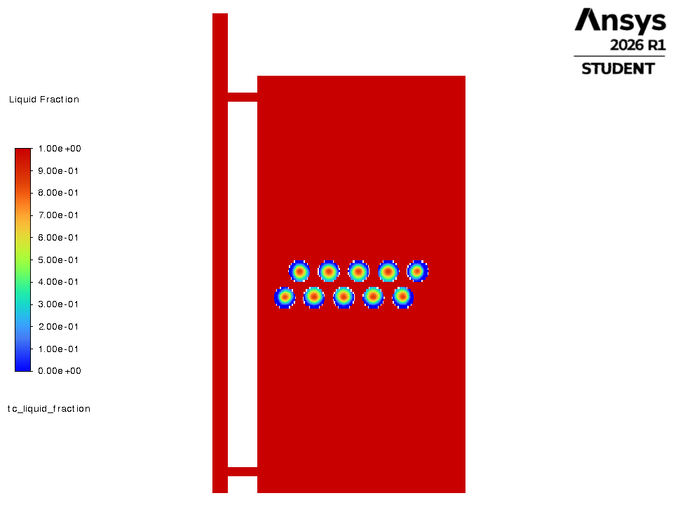

## 5. 10 % of the optimal PCM

N = 10 % of 104 = 10 capsules (R_in, flow, arrangement kept optimal: 10 % of the radius or flow would fall below the design-space / pump bounds).

Real design: R_in 40 mm, **10 capsules** (2.4 kg PCM), flow 0.0388 kg/s, staggered. Drawn in Fluent: 3 capsules.

Node model: g_window **26.9 kWh/yr (10 % of optimal)**, overheating 799 h/yr. Verdict: eliminated at Rule A (gain inside the noise band = no better than a plain tank).

| minute | water avg C | water max C | capsule avg C | liquid fraction | heat to water kJ/m |
|---|---|---|---|---|---|
| 0 | 30.00 | 30.00 | 70.00 | 1.000 | 0 |
| 15 | 30.29 | 48.75 | 58.29 | 0.582 | 374 |
| 30 | 30.40 | 49.43 | 55.62 | 0.420 | 522 |
| 45 | 30.48 | 49.19 | 53.95 | 0.304 | 626 |
| 60 | 30.55 | 48.69 | 52.49 | 0.213 | 709 |

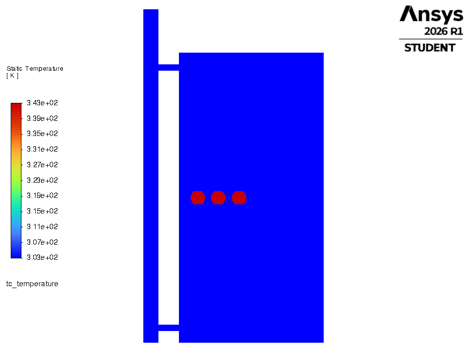
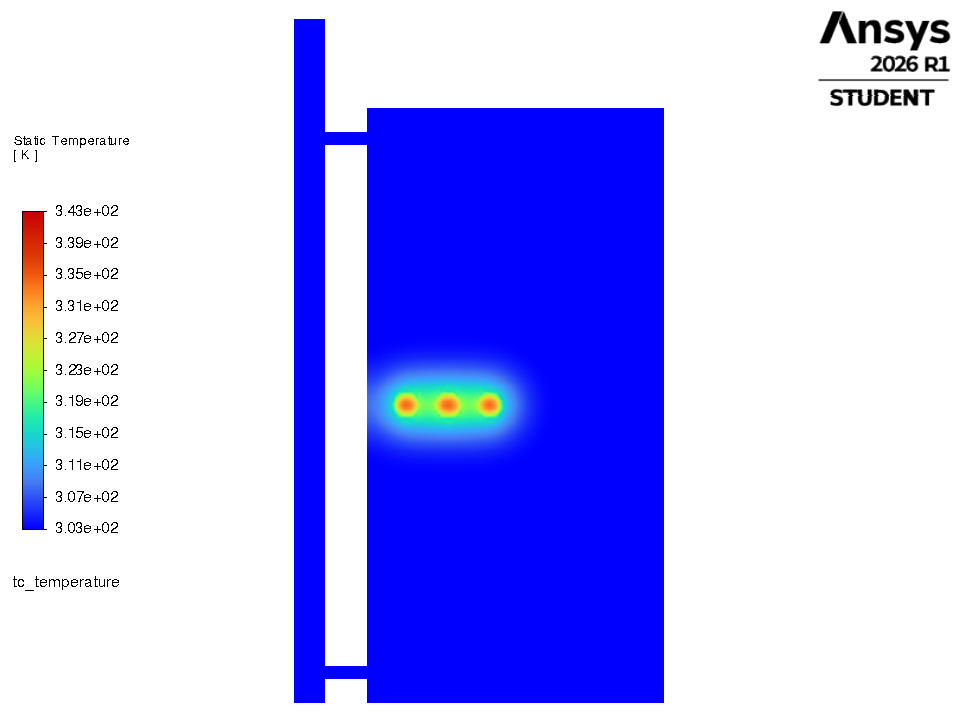
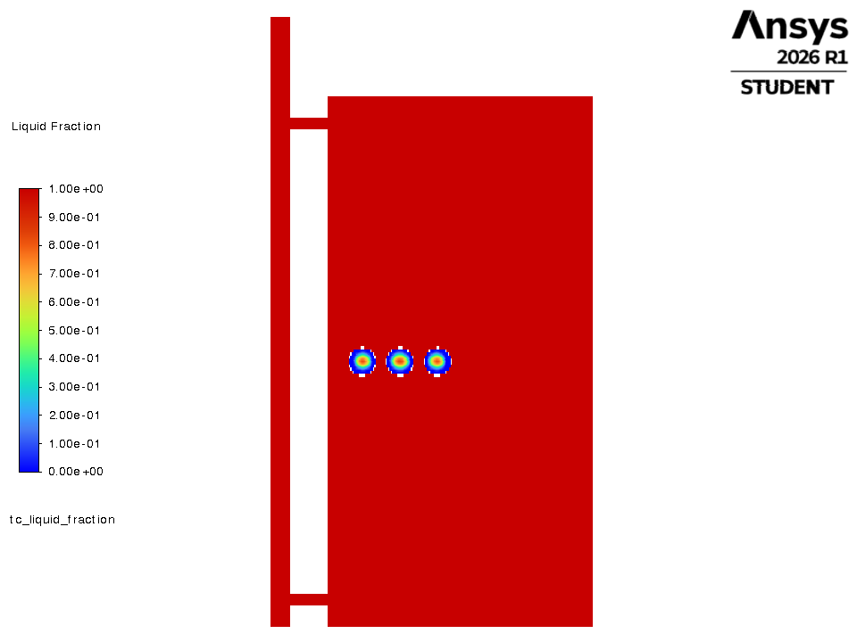

## 6. 50 % of the optimal PCM

N = 50 % of 104 = 52 capsules (R_in, flow, arrangement kept optimal).

Real design: R_in 40 mm, **52 capsules** (12.4 kg PCM), flow 0.0388 kg/s, staggered. Drawn in Fluent: 17 capsules.

Node model: g_window **148.5 kWh/yr (54 % of optimal)**, overheating 765 h/yr. Verdict: works and beats plain water, but eliminated at S0 (too far below the best g_window).

| minute | water avg C | water max C | capsule avg C | liquid fraction | heat to water kJ/m |
|---|---|---|---|---|---|
| 0 | 30.00 | 30.00 | 70.00 | 1.000 | 0 |
| 15 | 31.67 | 50.82 | 58.97 | 0.618 | 2037 |
| 30 | 32.17 | 53.30 | 57.39 | 0.492 | 2635 |
| 45 | 32.45 | 54.44 | 56.51 | 0.418 | 2985 |
| 60 | 32.67 | 55.17 | 55.83 | 0.363 | 3245 |

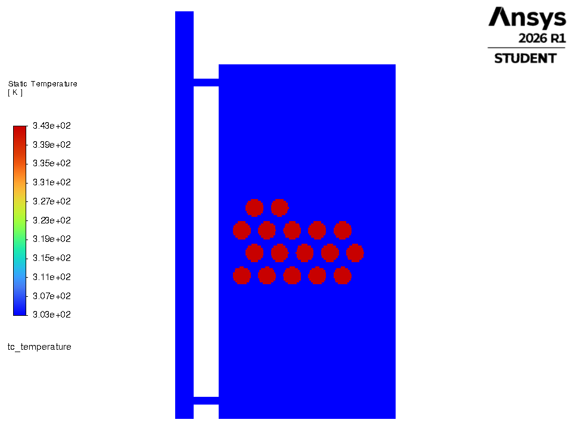
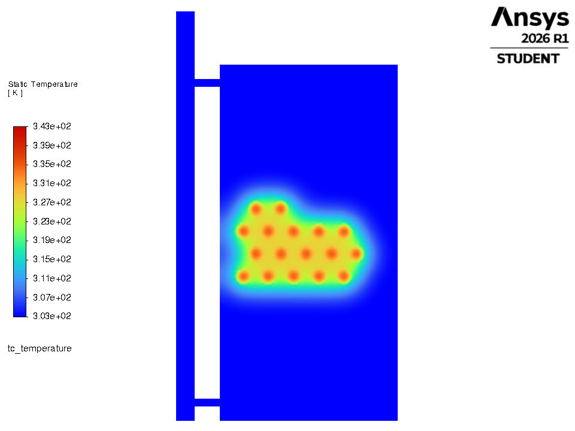
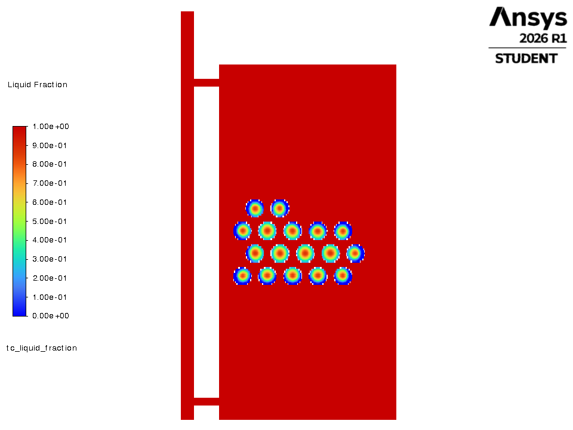

## What changes between criteria (Fluent, end of run)

| criteria | drawn capsules | water rise K | liquid fraction left | heat to water kJ/m | vs optimal |
|---|---|---|---|---|---|
| 0. OPTIMAL (reference) | 34 | 5.48 | 0.379 | 6135 | 100 % |
| 1. MAX of every parameter | 34 | 5.48 | 0.379 | 6135 | 100 % |
| 2. MIN of every parameter | 124 | 1.69 | 0.000 | 2125 | 35 % |
| 3. NOT optimal, but working | 26 | 4.10 | 0.381 | 4785 | 78 % |
| 4. YOUR WISH: only 30 capsules | 10 | 1.63 | 0.319 | 2050 | 33 % |
| 5. 10 % of the optimal PCM | 3 | 0.55 | 0.213 | 709 | 12 % |
| 6. 50 % of the optimal PCM | 17 | 2.67 | 0.363 | 3245 | 53 % |

Reading: more drawn capsules = more PCM area releasing latent heat = larger water temperature rise, and the optimum (34 drawn) releases the most; few capsules release little heat and finish solidifying sooner. Max-all has the same slice as the optimum (only flow differs, which acts in the node model).