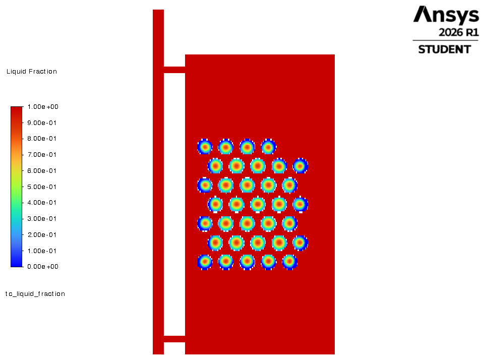
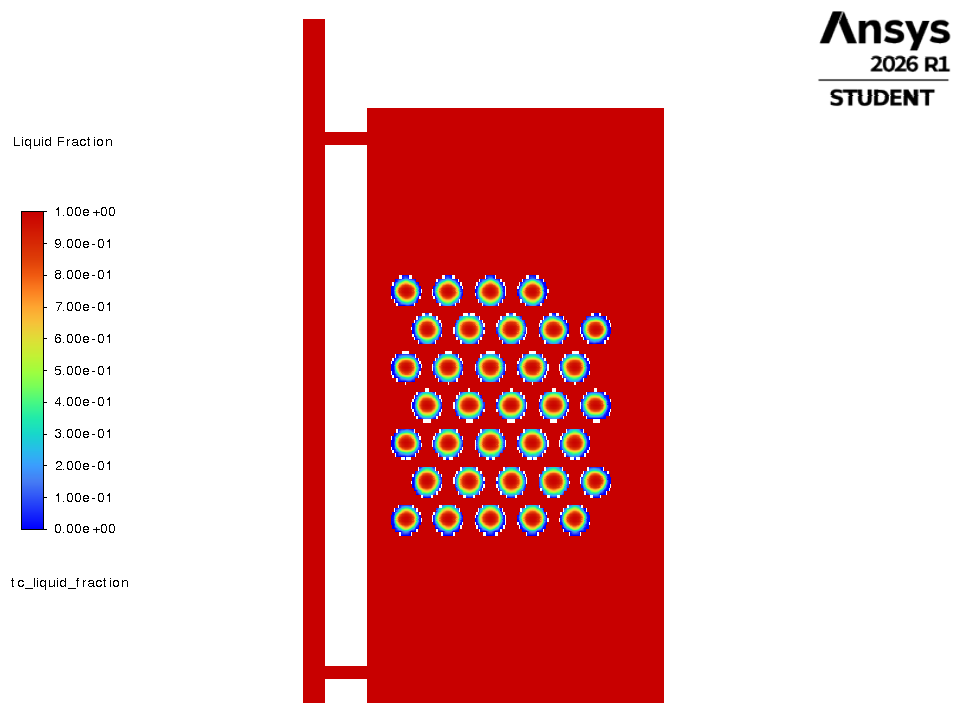
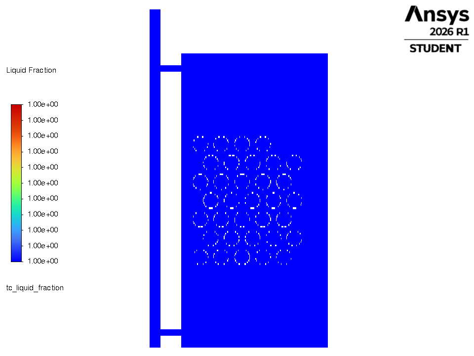
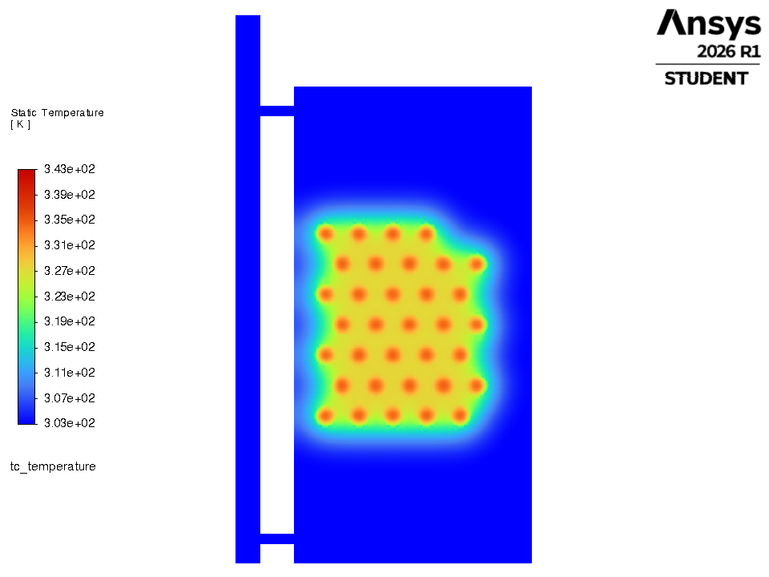
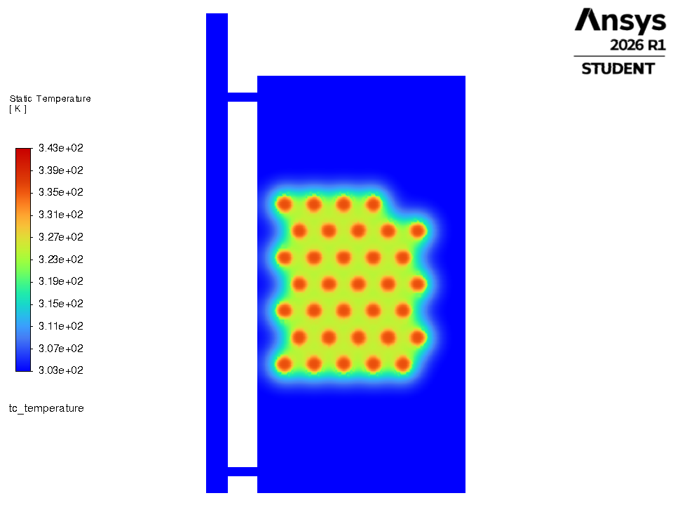
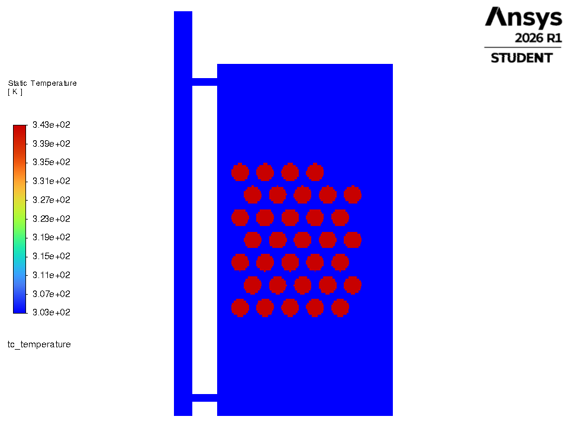

# 0. OPTIMAL (reference)

**Rule:** The optimiser's selected design (S0/S1/S2 funnel winner): the largest radius, ~30 % PCM fraction, a high-but-not-maximum flow.

## Parameters

| parameter | this criteria | optimal |
|---|---|---|
| capsule inner radius | 40.0 mm | 40.0 mm |
| capsules (real, 3-D) | 104 (100 % of optimal) | 104 |
| PCM volume fraction | 29.6 % | 29.6 % |
| flow | 0.0388 kg/s | 0.0388 kg/s |
| arrangement | staggered | staggered |
| PCM | PureTemp 58 (Regime 0) | PureTemp 58 |
| **drawn in Fluent (2-D proxy)** | **34 capsules, inner R 20.0 mm** | 34, 20 mm |

## Result of the optimiser's own simulator (select years 2021-23, vs plain water tank)

| metric | this criteria | optimal | difference |
|---|---|---|---|
| PCM mass | 24.8 kg | 24.8 kg | +0.0 |
| **g_window** (extra evening heat) | **276.6 kWh/yr** | 276.6 | +0.0  (100 % of optimal) |
| g_annual | 283.1 kWh/yr | 283.1 | +0.0 |
| d_overheat (lower better) | 829 h/yr | 829 | +0 |
| peak PCM T | 62.34 C (limit 65) | | PASS |
| peak water T | 72.07 C (limit 75) | | PASS |

## How the final design is selected - and where this one stops

* Rule A (gain > 28.4 kWh noise band): **pass**
* S0 (within the band of the best g_window 297.1): **in**
* S1 (low overheating, only for S0 members): **in**
* **Verdict:** OPTIMAL (this is the selected design)

**Why it is not optimal:** It IS the optimum - reference for every other run.

## Files

| file | what |
|---|---|
| `criteria.json` | design, 2-D proxy, run settings |
| `fluent_tank_discharge_criteria.py` | copy of `../fluent_tank_discharge.py` driven by this criteria (builds its own mesh, runs Fluent, prints the time table, saves pictures) |
| `make_system_mesh.py` | mesh builder with an exact `n_capsules` argument |
| `run_node_model.py`, `scenarios.py` | the objective-value side (gates, funnel verdict, one-day time behaviour) |
| `node_model_terminal.txt`, `node_model_results.json`, `node_model_day.csv/.png` | its output |
| `fluent_terminal.log`, `*_discharge_timeseries.csv`, `figures/*.png` | Fluent output (after `python fluent_tank_discharge_criteria.py`) |

## Fluent whole-tank discharge (this run)

water 30.00 -> 35.48 C; capsules 70.00 -> 56.17 C; liquid fraction 1.00 -> 0.38; heat given to the water 6135 kJ per metre of depth.

