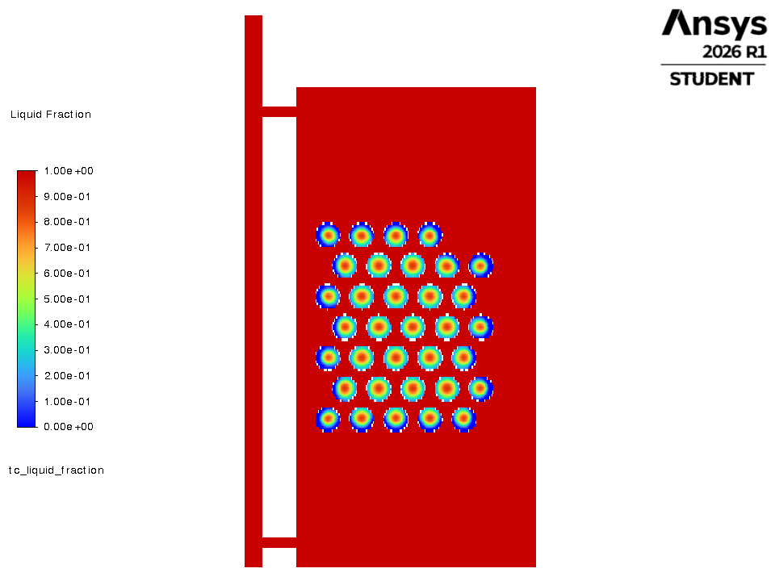
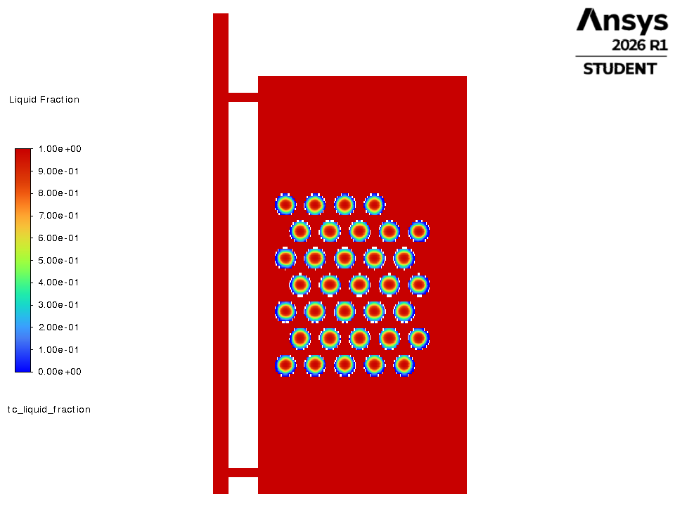
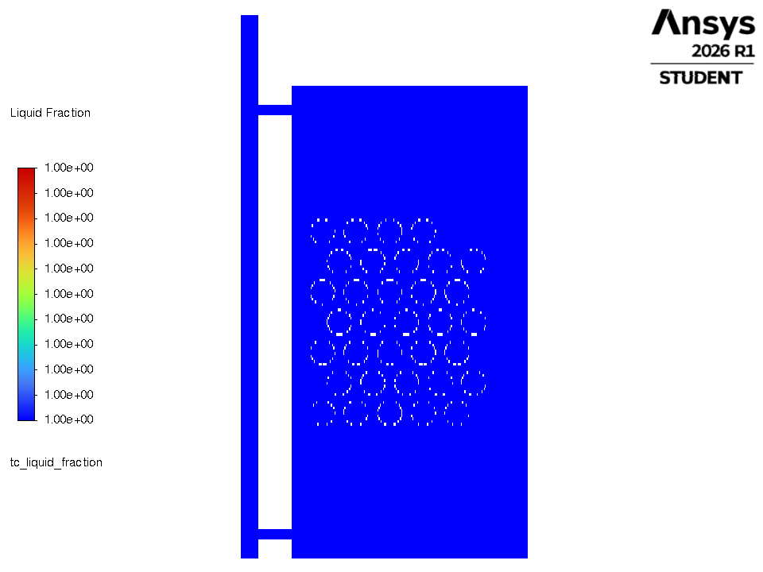
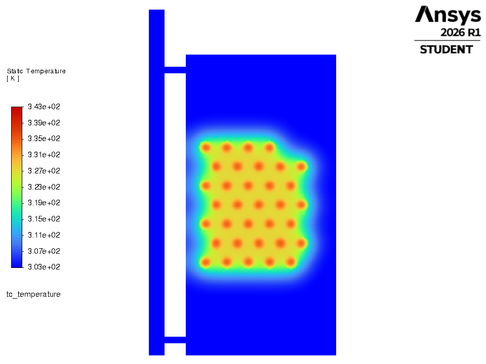
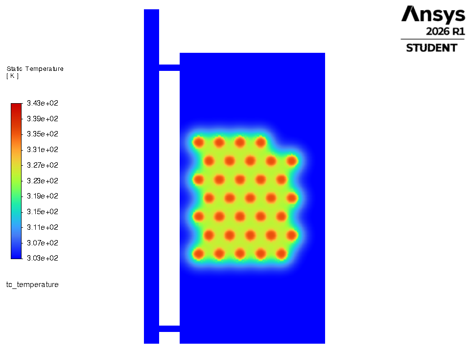
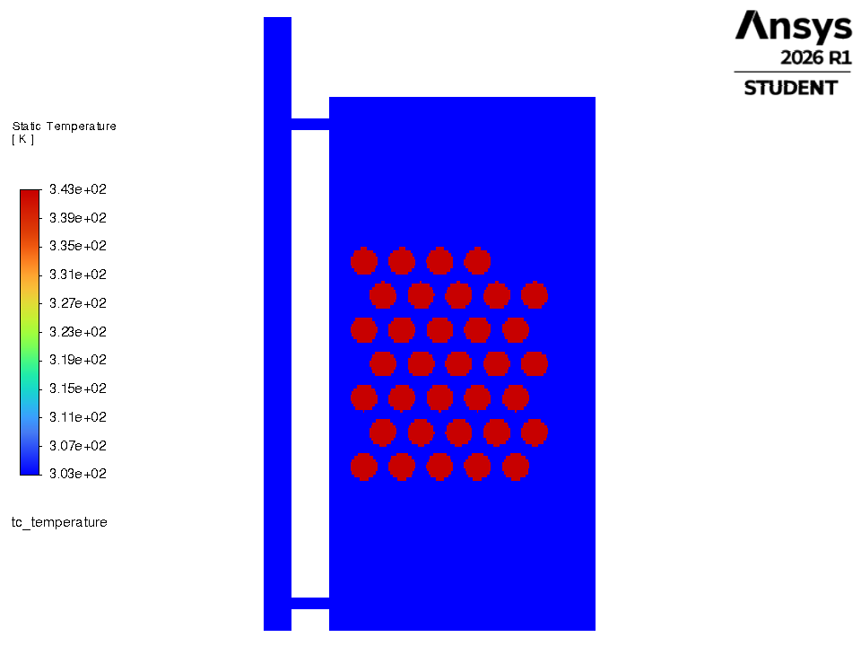

# 1. MAX of every parameter

**Rule:** Every knob at its upper bound: R_in 40 mm, PCM fraction 30 %, flow 0.050 kg/s, densest packing (staggered).  N follows from R and fraction (the 30 % cap at R = 40 mm gives N = 105).

## Parameters

| parameter | this criteria | optimal |
|---|---|---|
| capsule inner radius | 40.0 mm | 40.0 mm |
| capsules (real, 3-D) | 105 (101 % of optimal) | 104 |
| PCM volume fraction | 29.9 % | 29.6 % |
| flow | 0.0500 kg/s | 0.0388 kg/s |
| arrangement | staggered | staggered |
| PCM | PureTemp 58 (Regime 0) | PureTemp 58 |
| **drawn in Fluent (2-D proxy)** | **34 capsules, inner R 20.0 mm** | 34, 20 mm |

## Result of the optimiser's own simulator (select years 2021-23, vs plain water tank)

| metric | this criteria | optimal | difference |
|---|---|---|---|
| PCM mass | 25.1 kg | 24.8 kg | +0.2 |
| **g_window** (extra evening heat) | **283.3 kWh/yr** | 276.6 | +6.7  (102 % of optimal) |
| g_annual | 290.8 kWh/yr | 283.1 | +7.8 |
| d_overheat (lower better) | 880 h/yr | 829 | +51 |
| peak PCM T | 62.36 C (limit 65) | | PASS |
| peak water T | 72.08 C (limit 75) | | PASS |

## How the final design is selected - and where this one stops

* Rule A (gain > 28.4 kWh noise band): **pass**
* S0 (within the band of the best g_window 297.1): **in**
* S1 (low overheating, only for S0 members): **in**
* **Verdict:** statistically TIED with the optimum (gain difference +6.7 kWh is inside the 28.4 kWh band); loses the final tie-break: PCM mass 25.05 vs 24.81 kg, 105 vs 104 capsules

**Why it is not optimal:** Radius and fraction were ALREADY at their bounds in the optimum (R 40 mm, 29.6 % of a 30 % cap), so the only real changes are +1 capsule and a higher flow (0.050 vs 0.0388). The gain is marginally higher but the difference sits INSIDE the repeatability band, so the funnel treats it as a tie and breaks it on cost: more PCM mass, more capsules, more overheating.

## Files

| file | what |
|---|---|
| `criteria.json` | design, 2-D proxy, run settings |
| `fluent_tank_discharge_criteria.py` | copy of `../fluent_tank_discharge.py` driven by this criteria (builds its own mesh, runs Fluent, prints the time table, saves pictures) |
| `make_system_mesh.py` | mesh builder with an exact `n_capsules` argument |
| `run_node_model.py`, `scenarios.py` | the objective-value side (gates, funnel verdict, one-day time behaviour) |
| `node_model_terminal.txt`, `node_model_results.json`, `node_model_day.csv/.png` | its output |
| `fluent_terminal.log`, `*_discharge_timeseries.csv`, `figures/*.png` | Fluent output (after `python fluent_tank_discharge_criteria.py`) |

## Fluent whole-tank discharge (this run)

water 30.00 -> 35.48 C; capsules 70.00 -> 56.17 C; liquid fraction 1.00 -> 0.38; heat given to the water 6135 kJ per metre of depth.

