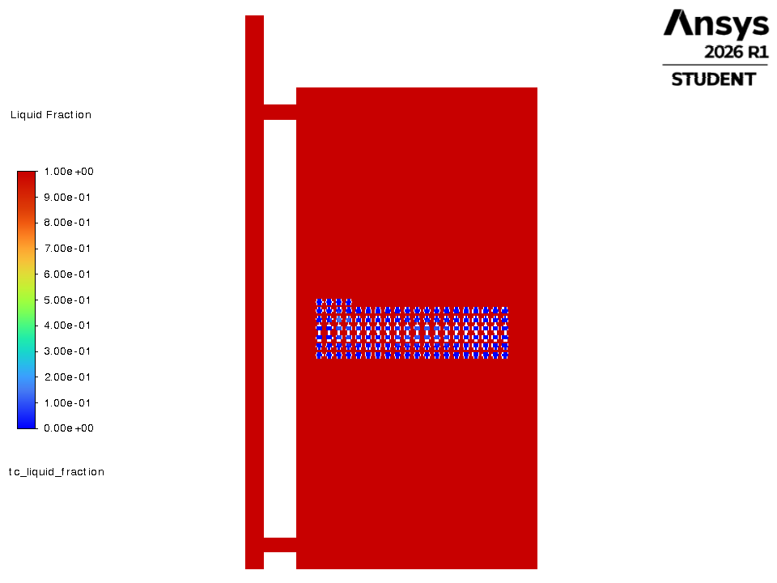
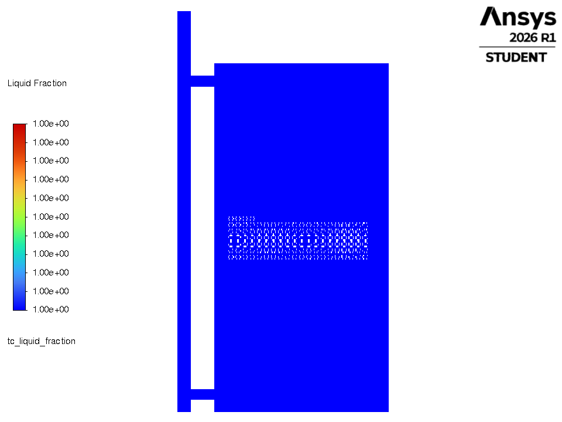
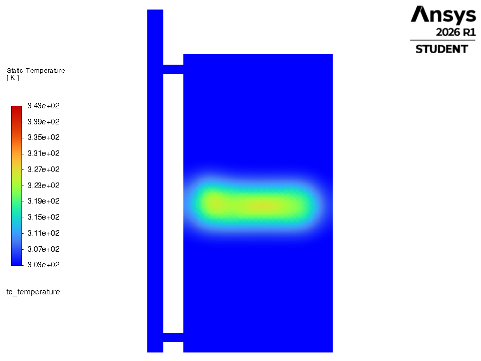
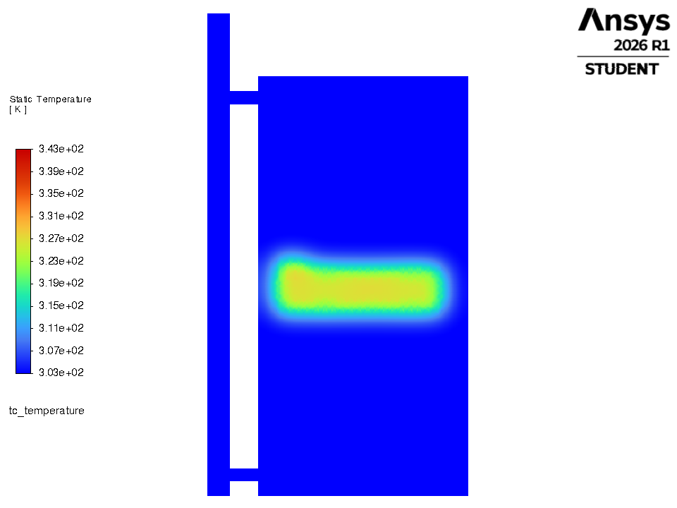
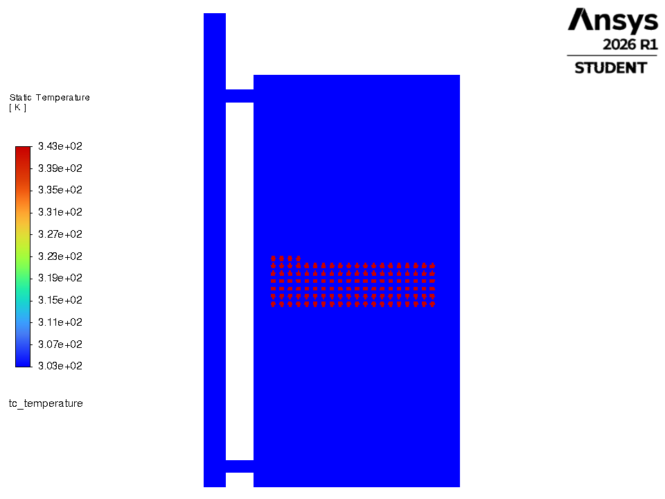

# 2. MIN of every parameter

**Rule:** Every knob at its lower bound: R_in 10 mm, PCM fraction 2 %, flow 0.010 kg/s, loosest packing (single-layer).  N = 380 tiny capsules but only ~2 % of the tank volume (1.4 kg of PCM).

## Parameters

| parameter | this criteria | optimal |
|---|---|---|
| capsule inner radius | 10.0 mm | 40.0 mm |
| capsules (real, 3-D) | 380 (365 % of optimal) | 104 |
| PCM volume fraction | 2.0 % | 29.6 % |
| flow | 0.0100 kg/s | 0.0388 kg/s |
| arrangement | single-layer | staggered |
| PCM | PureTemp 58 (Regime 0) | PureTemp 58 |
| **drawn in Fluent (2-D proxy)** | **124 capsules, inner R 5.0 mm** | 34, 20 mm |

## Result of the optimiser's own simulator (select years 2021-23, vs plain water tank)

| metric | this criteria | optimal | difference |
|---|---|---|---|
| PCM mass | 1.4 kg | 24.8 kg | -23.4 |
| **g_window** (extra evening heat) | **2.2 kWh/yr** | 276.6 | -274.4  (1 % of optimal) |
| g_annual | 2.2 kWh/yr | 283.1 | -280.8 |
| d_overheat (lower better) | 1418 h/yr | 829 | +589 |
| peak PCM T | 62.58 C (limit 65) | | PASS |
| peak water T | 72.26 C (limit 75) | | PASS |

## How the final design is selected - and where this one stops

* Rule A (gain > 28.4 kWh noise band): **FAIL**
* S0 (within the band of the best g_window 297.1): **OUT**
* S1 (low overheating, only for S0 members): **n/a**
* **Verdict:** eliminated at Rule A (gain inside the noise band = no better than a plain tank)

**Why it is not optimal:** Almost no PCM (1.4 kg, 2 % of the tank), so almost no latent storage: the gain (2.2 kWh/yr) is ~1 % of the optimum and far inside the repeatability band - indistinguishable from plain water.

## Files

| file | what |
|---|---|
| `criteria.json` | design, 2-D proxy, run settings |
| `fluent_tank_discharge_criteria.py` | copy of `../fluent_tank_discharge.py` driven by this criteria (builds its own mesh, runs Fluent, prints the time table, saves pictures) |
| `make_system_mesh.py` | mesh builder with an exact `n_capsules` argument |
| `run_node_model.py`, `scenarios.py` | the objective-value side (gates, funnel verdict, one-day time behaviour) |
| `node_model_terminal.txt`, `node_model_results.json`, `node_model_day.csv/.png` | its output |
| `fluent_terminal.log`, `*_discharge_timeseries.csv`, `figures/*.png` | Fluent output (after `python fluent_tank_discharge_criteria.py`) |

## Fluent whole-tank discharge (this run)

water 30.00 -> 31.69 C; capsules 70.00 -> 46.73 C; liquid fraction 1.00 -> 0.00; heat given to the water 2125 kJ per metre of depth.

