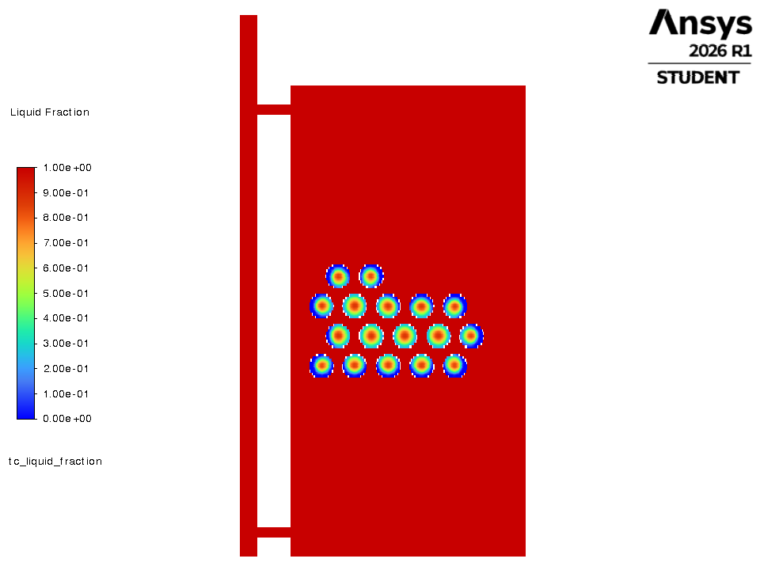
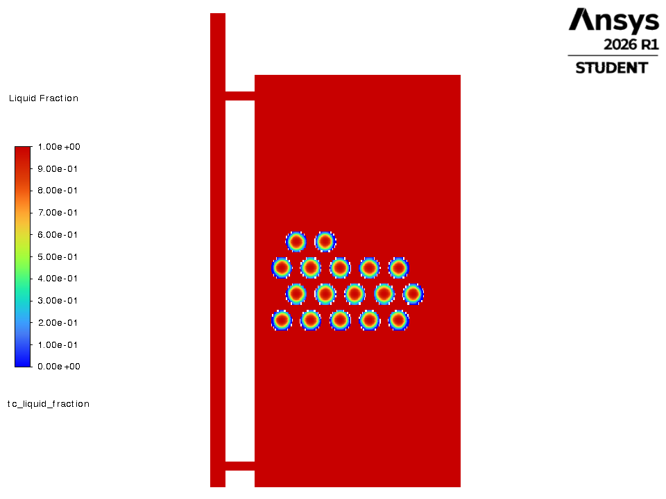
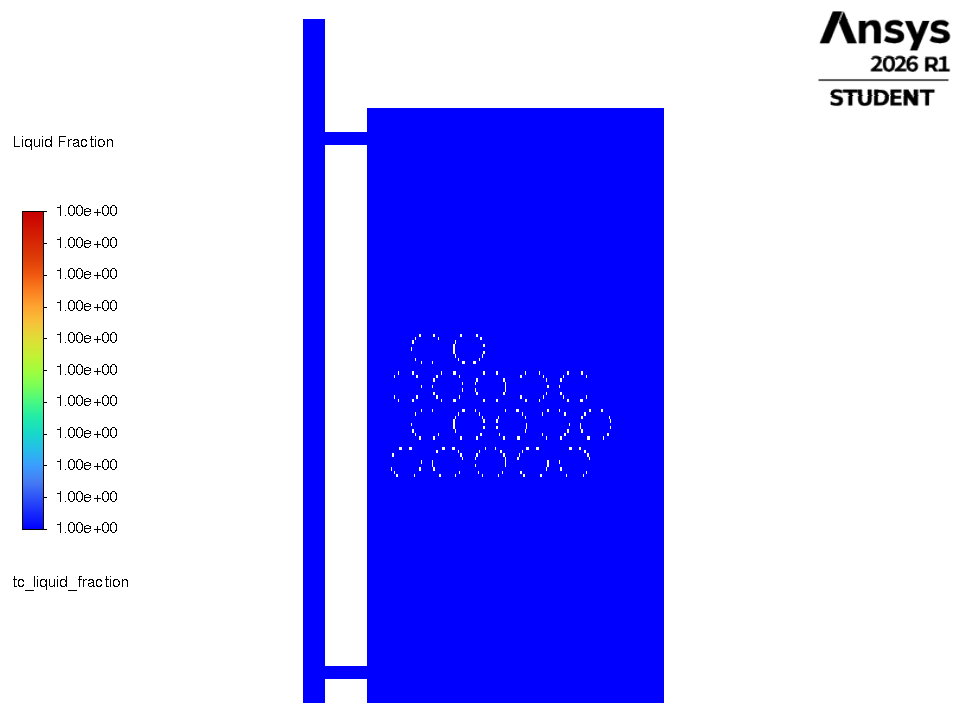
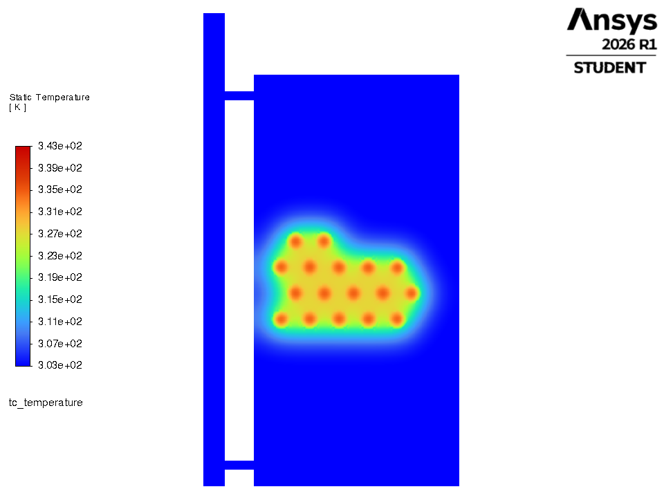
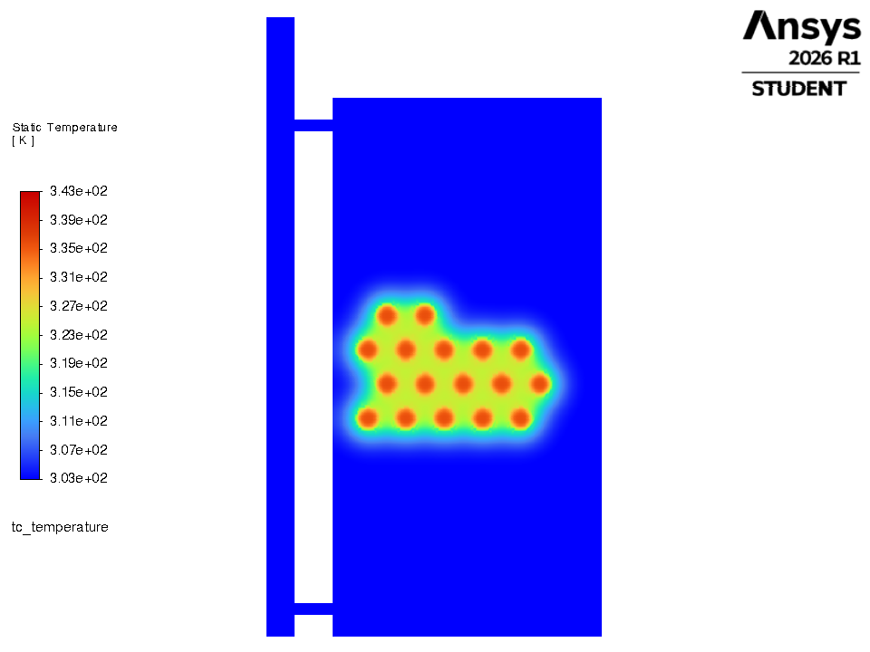
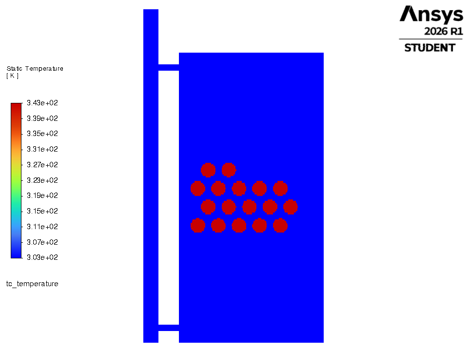

# 6. 50 % of the optimal PCM

**Rule:** N = 50 % of 104 = 52 capsules (R_in, flow, arrangement kept optimal).

## Parameters

| parameter | this criteria | optimal |
|---|---|---|
| capsule inner radius | 40.0 mm | 40.0 mm |
| capsules (real, 3-D) | 52 (50 % of optimal) | 104 |
| PCM volume fraction | 14.8 % | 29.6 % |
| flow | 0.0388 kg/s | 0.0388 kg/s |
| arrangement | staggered | staggered |
| PCM | PureTemp 58 (Regime 0) | PureTemp 58 |
| **drawn in Fluent (2-D proxy)** | **17 capsules, inner R 20.0 mm** | 34, 20 mm |

## Result of the optimiser's own simulator (select years 2021-23, vs plain water tank)

| metric | this criteria | optimal | difference |
|---|---|---|---|
| PCM mass | 12.4 kg | 24.8 kg | -12.4 |
| **g_window** (extra evening heat) | **148.5 kWh/yr** | 276.6 | -128.1  (54 % of optimal) |
| g_annual | 152.0 kWh/yr | 283.1 | -131.0 |
| d_overheat (lower better) | 765 h/yr | 829 | -64 |
| peak PCM T | 62.34 C (limit 65) | | PASS |
| peak water T | 72.05 C (limit 75) | | PASS |

## How the final design is selected - and where this one stops

* Rule A (gain > 28.4 kWh noise band): **pass**
* S0 (within the band of the best g_window 297.1): **OUT**
* S1 (low overheating, only for S0 members): **n/a**
* **Verdict:** works and beats plain water, but eliminated at S0 (too far below the best g_window)

**Why it is not optimal:** Half the PCM gives ~54 % of the gain - the benefit grows roughly in proportion to PCM mass up to the 30 % volume cap, which is why the optimiser pushes to the cap.

## Files

| file | what |
|---|---|
| `criteria.json` | design, 2-D proxy, run settings |
| `fluent_tank_discharge_criteria.py` | copy of `../fluent_tank_discharge.py` driven by this criteria (builds its own mesh, runs Fluent, prints the time table, saves pictures) |
| `make_system_mesh.py` | mesh builder with an exact `n_capsules` argument |
| `run_node_model.py`, `scenarios.py` | the objective-value side (gates, funnel verdict, one-day time behaviour) |
| `node_model_terminal.txt`, `node_model_results.json`, `node_model_day.csv/.png` | its output |
| `fluent_terminal.log`, `*_discharge_timeseries.csv`, `figures/*.png` | Fluent output (after `python fluent_tank_discharge_criteria.py`) |

## Fluent whole-tank discharge (this run)

water 30.00 -> 32.67 C; capsules 70.00 -> 55.83 C; liquid fraction 1.00 -> 0.36; heat given to the water 3245 kJ per metre of depth.

